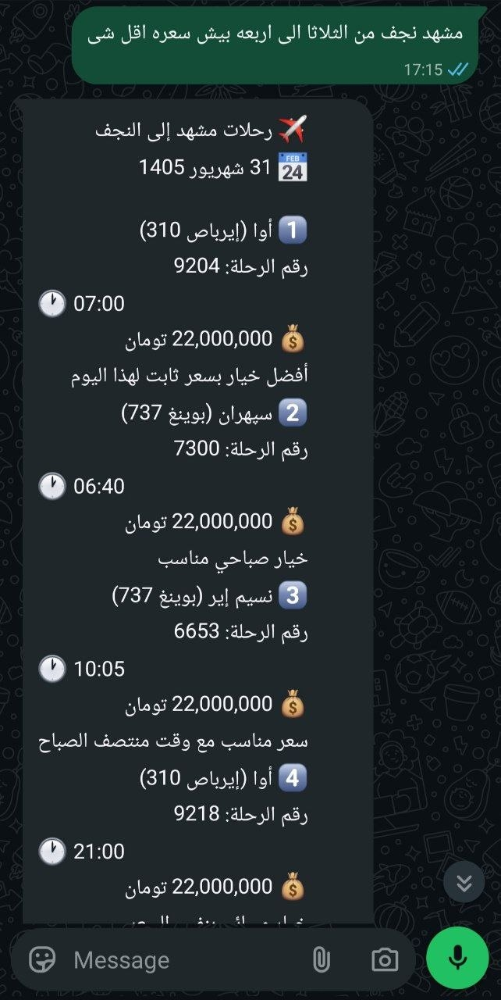
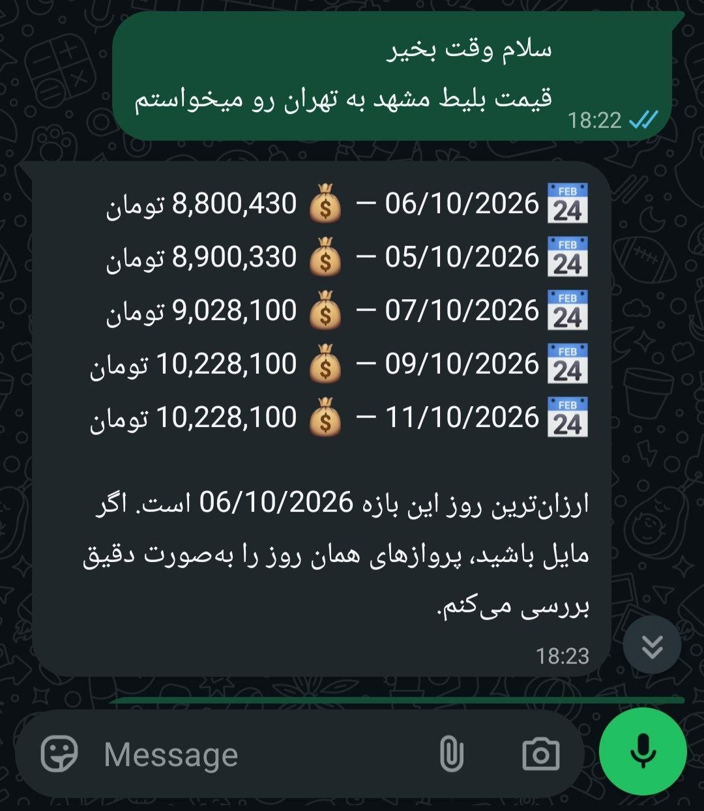
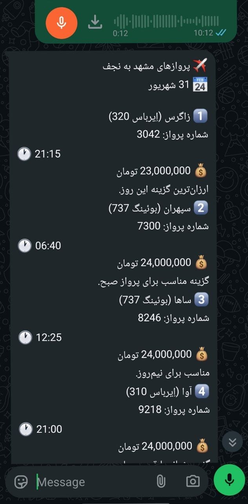

# AI-Powered WhatsApp Flight Booking Assistant

An AI-powered WhatsApp assistant designed to automate flight inquiries and reduce the workload of customer support teams for a travel agency.

## Business Impact

| Metric | Before | After |
|---|---|---|
| Customer response time | ~10 minutes | ~30 seconds |
| Support workload | Baseline | ~90% reduction in support needs |

The assistant handles routine flight inquiries automatically, helping customers receive flight information faster while reducing the need for manual support.

## The Problems It Solves

**1. Slow customer responses**

Customers often have to wait for an agent to check flight availability, compare prices, and respond to their questions.

**Solution:** The assistant processes flight inquiries and returns relevant results in approximately 30 seconds.

**2. High customer support workload**

Support agents spend a significant amount of time answering repetitive questions about routes, travel dates, flight availability, and ticket prices.

**Solution:** The assistant automates routine inquiries, reducing support needs by approximately 90%.

**3. Language barriers**

Travel agencies may receive inquiries in different languages, making it harder to provide a consistent customer experience.

**Solution:** The assistant supports Persian and Arabic conversations, allowing customers to communicate naturally in their preferred language.

**4. Repetitive flight searches**

Customers frequently ask for flights between different cities, dates, and price ranges.

**Solution:** The assistant interprets natural-language requests and retrieves relevant flight options and pricing information.

**5. Growing support costs**

As inquiry volume increases, agencies may need additional staff or spend more time handling routine requests.

**Solution:** Automating repetitive inquiries allows the support team to focus on cases that require human assistance.

## Demo

### 1. Flight Recommendations in Persian

### 2. Arabic Flight Inquiry

### 3. Daily Flight Price Comparison

### 4. Voice Message Interaction

## How It Works

1. The customer sends a flight inquiry through WhatsApp.
2. The AI interprets the request, including the route, travel dates, and relevant preferences.
3. The system retrieves flight information from the connected flight data provider.
4. Available options and prices are presented in a natural, customer-friendly response.
5. Requests that cannot be handled automatically can be directed to human support.

## Technical Highlights

- **LLM-based request understanding:** Converts natural-language messages into structured information.
- **Graph-based workflow:** Uses LangGraph to manage processing steps and routing decisions.
- **Flight data integration:** Retrieves relevant flight information and pricing.
- **Multilingual interaction:** Supports Persian and Arabic customer inquiries.
- **Date-aware processing:** Handles travel dates and date conversions.
- **Conversation context:** Maintains relevant context across interactions.
- **Monitoring and logging:** Supports debugging and workflow observability.

## Technology Stack

Python · FastAPI · LangGraph · OpenAI-compatible LLM APIs · Pydantic · SQLAlchemy · AsyncIO

## Project Focus

This project demonstrates how AI can solve a real operational problem by automating repetitive customer interactions, reducing response times, and lowering the workload on customer support teams.

*This repository presents a portfolio case study. The production source code and private integrations are not included.*

